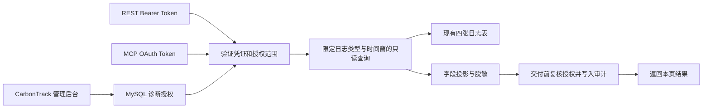

# CarbonTrack 外部 Agent 日志诊断技术方案

日期 2026-11-19 · 实现分支 `codex/ai-log-diagnostics`

## 1. 交付目标

管理员从「系统日志」创建一条临时、可撤销的只读授权，为指定时间窗和日志类型开放诊断。外部 Agent 可以用 REST Bearer Token，或通过远程 MCP 的 OAuth 流程调用同一组能力，先看统计，再筛选记录，最后按请求还原上下文。

首版覆盖系统、错误、审计日志。LLM 日志单独勾选授权，开放调用元数据。授权、查询、脱敏与审计在现有 Slim 后端执行，复用 `DatabaseService` 提供的 Illuminate 连接和 MySQL 日志表。

累计返回字节和累计调用次数只做使用统计。字段通过脱敏后完整返回，摘要保留其实际长度。查询成本由时间窗、按页读取、速率、并发和执行超时控制。

## 2. 现有能力与数据映射

| 类型 | 数据源与时间列 | 对外字段 |
| --- | --- | --- |
| `system` | `system_logs.created_at` | 日志 ID、时间、`request_id`、HTTP 方法、可识别的路由模板、状态码和耗时 |
| `error` | `error_logs.error_time` | 日志 ID、时间、`request_id`、异常类别、可安全输出的脱敏消息、可识别的项目相对位置和行号 |
| `audit` | `audit_logs.created_at` | 日志 ID、时间、`request_id`、受控的动作与操作类别、操作者角色和执行状态 |
| `llm` | `llm_logs.created_at` | 日志 ID、时间、`request_id`、受控的来源和模型名、调用状态、耗时与用量计数。默认关闭，单独授权 |

后台在 `/api/v1/admin/logs` 下提供 `/search`、`/related` 和 `/export`。`related` 已使用 `request_id` 串联四张表。诊断网关复用表字段、关联键及请求 ID 规范，使用独立的授权查询与字段白名单。 [日志表定义](../backend/database/localhost.sql) · [后台路由](../backend/src/routes.php) · [后台日志查询](../backend/src/Controllers/LogSearchController.php)

授权绑定**当前部署的日志库**。日志表缺少统一的租户、环境、服务或实例字段，授权表单只提供能由数据库条件强制执行的范围。部署间隔离由部署配置和数据库连接保证。上线前核实对外启用的部署使用隔离的日志库。路由、审计动作、LLM 来源等现有字段作为查询筛选项。

请求级上下文使用 `request_id`。缺少该字段的历史记录可单条查看，标明关联信息缺失。跨服务调用图、SQL 耗时、RPC 指标和完整堆栈需要有对应采集字段后才能纳入契约。

## 3. 授权与后台流程

1. 在 [系统日志页](../frontend/src/pages/admin/SystemLogs.jsx) 打开「AI 诊断授权」。表单可沿用当前时间筛选和已选的系统、错误、审计类型。LLM 选择始终由管理员在本表单中明确勾选。默认日志窗口为最近两小时，默认有效期为 30 分钟。名称可自动生成。
2. 服务端使用现有后台认证，复查真实账号、管理员权限和账号状态。创建时将相对时间转为固定区间 `[from, to)`。API 接收带时区的 RFC 3339 时间，比较前转换为各日志源的存储时区。以部署核验的 PHP 和 MySQL 时区为准，查询层统一归一化输出。
3. 选择 REST 时，创建者可签发临时凭证。响应只展示一次 Token、REST 地址和到期时间。选择 MCP 时，界面给出连接地址。客户端发起 OAuth 后，创建者登录 CarbonTrack，从自己仍有效的诊断授权中选择一条并确认。两种凭证可绑定同一授权。
4. 当前有权限的管理员可查看授权、凭证状态和调用历史，并撤销单枚凭证或整条授权。新建授权即可调整日志类型或时间窗。撤销和到期均为终止状态。创建者被停用、删除或降权时，后续调用按当前账号状态拒绝。
5. 日志页展示范围、创建人、到期时间、接入方式、使用次数和审计记录。现有表单、对话框、TanStack Query 与 `admin` 翻译命名空间覆盖此流程。OAuth 同意页面显示客户端、当前部署、授权内容及到期时间。Token 仅保存在当次界面内存中，由管理员主动复制。

### 预定的后台接口

以 `/api/v1/admin/log-diagnostics` 为前缀，全部使用后台 JWT 和现有管理员权限检查。

| 方法与路径 | 用途 |
| --- | --- |
| `GET /settings` | 查看诊断可用状态。启用时记录操作审计，再返回接入地址及最长授权时长 |
| `POST /sessions` | 创建授权，可随同签发首枚 REST Token |
| `GET /sessions`、`GET /sessions/{id}` | 分页查看授权及凭证元数据 |
| `POST /sessions/{id}/credentials` | 创建者签发 REST Token |
| `POST /sessions/{id}/revoke` | 撤销授权和其下全部凭证 |
| `POST /sessions/{id}/credentials/{credential_id}/revoke` | 撤销指定凭证 |
| `GET /sessions/{id}/access-audits` | 分页查看诊断访问审计 |
| `GET /oauth-requests/{id}`、`POST /oauth-requests/{id}/decision` | 查阅已验证的 OAuth 请求并提交同意或拒绝 |

撤销操作可重复提交并返回同一终态。签发响应和 OAuth 响应使用 `Cache-Control: no-store`。签发及诊断查询路由排除响应缓存与幂等响应重放，确保每次读取重新校验。 [现有管理员校验](../backend/src/Middleware/AdminMiddleware.php) · [幂等中间件](../backend/src/Middleware/IdempotencyMiddleware.php)

## 4. 共享查询接口



REST 前缀为 `/api/v1/log-diagnostics`。三个操作接收 JSON。MCP 工具沿用同一参数及响应模型，参数按明确的类型和允许值校验。每次请求先确定有效授权，再构造查询。可选的时间和类型参数缺省时沿用授权范围，显式越界返回拒绝。所有关联查询及聚合的子查询均使用同一授权范围。

| REST | MCP 工具 | 输入和结果 |
| --- | --- | --- |
| `POST /summary` | `get_log_summary` | 可指定已授权类型和更窄的时间区间。返回按类型计数、系统日志 HTTP 状态分布、按时间桶统计的错误趋势，以及高频 `error_type` 的次数、首次与最近发生时间和脱敏示例。错误类别可以直接传给检索工具。 |
| `POST /search` | `search_logs` | 指定一种日志类型，可按时间、`request_id` 和该类型的结构化字段筛选。支持字面关键词和游标。结果为投影后的日志列表。 |
| `POST /context` | `get_trace_context` | 传 `request_id` 或 `{type, id}` 二选一。以日志 ID 查询时先在授权内定位锚点，再按其请求 ID 关联授权内的记录。时间正序返回，同时间按类型与 ID 排序。无请求 ID 时返回锚点并标明缺少关联键。 |

结构化筛选以实际列为准，例如系统日志的状态码和方法、错误类型、审计动作及状态、LLM 的模型和状态。关键词只在对外可见的字段上作字面匹配。可安全直接比较的元数据交给 SQL，需脱敏的消息先投影再匹配，避免用命中结果推断原始敏感内容。

检索和上下文每页上限建议为 50 条，允许传入更小的页大小。检索按时间和 ID 逆序，游标签名绑定授权、操作、规范化过滤条件、首屏各来源的最大 ID 和翻页位置。下一页从游标继续，仍需校验当前授权。搜索在候选批次间达到工作预算时，可在已处理边界返回 `next_cursor`，同时用 `has_more` 表明可继续。底层查询超时时返回明确错误。

聚合按对外可见的异常类别分组，未知类别合入通用项。代表记录与计数采用同一有效范围。可选列以字段是否可用来表达，旧记录仍可用已有 ID、时间和类别定位。结果标注为不可信日志数据，MCP 工具标注只读。

## 5. 凭证与 MCP OAuth

### 5.1 REST 与 MCP 的凭证边界

REST 和 MCP 使用不同用途的不透明 Token，均通过 `Authorization: Bearer` 走 HTTPS。各自的签发前缀方便运维识别，后端依据数据库中的用途和受众校验。Token 使用 `random_bytes(32)` 生成随机值，MySQL 只存 SHA-256 摘要及凭证元数据。MCP 凭证额外绑定 OAuth 客户端，受众为配置中的完整 MCP 资源地址。REST 凭证只接受于诊断 REST 接口，后台 JWT 用于后台管理。

授权和凭证到期时间都由服务端校验。MCP Access Token 最晚在关联诊断授权到期时失效。授权失效后，重新接入需要管理员选择一条有效授权。首版 OAuth 只发短期 Access Token。

### 5.2 接入协议与客户端

| 配置 | 首版设计 |
| --- | --- |
| MCP 资源 | `/api/v1/log-diagnostics/mcp`，Streamable HTTP，单次工具调用返回完整 JSON |
| MCP 版本 | 以 `2026-07-28` 的请求级版本协商与 `server/discover` 支持新客户端，同时服务采用 `2025-11-25` 握手的客户端。以 ChatGPT 与 Claude 的测试结果记录实际支持的版本 |
| PHP 适配 | 官方 `mcp/sdk` v0.10 与 Slim PSR-7 对接，使用无状态传输。协议适配器只注册三项诊断工具，每次日志调用都校验凭证 |
| 客户端身份 | 首选 ChatGPT、Claude 的发布身份和 Client ID Metadata Document（CIMD）。按后台配置允许指定供应商元数据地址和精确回调 URI。需预注册的客户端以显式登记的 ID 和回调对接 |
| 客户端验收 | ChatGPT 自定义插件和 Claude 自定义连接器在测试环境分别验证工具发现、授权、数据读取、到期和撤销。客户端的工作区需有对应连接器权限 |

启用官方 SDK 前验证当前 Composer 锁可解析，且 SDK 版本同时覆盖所选两代协议。握手版可对未提供的 GET SSE 通道返回 `405`。按所选协议处理版本、请求头、通知和 `Origin`。 [MCP 版本](https://modelcontextprotocol.io/specification/versioning) · [Streamable HTTP 规范](https://modelcontextprotocol.io/specification/2026-07-28/basic/transports/streamable-http) · [PHP SDK 发布说明](https://github.com/modelcontextprotocol/php-sdk/releases)

CIMD 元数据可以从运维登记的 HTTPS 地址在线取得，也可以在客户端登记时加入已核验的文档。两种方式都核验文档 `client_id`、回调 URI 和通告的客户端认证方式。在线访问限制到登记端点，跨站重定向与内网地址拒绝。公共客户端使用 PKCE 并按 `none` 换码。机密客户端的密钥只做摘要校验。使用 `private_key_jwt` 的连接器按登记的 JWKS 校验签名、发行者、受众、有效期和断言重放。 [MCP 客户端注册](https://modelcontextprotocol.io/specification/2026-07-28/basic/authorization/client-registration) · [CIMD 草案 §9.2](https://datatracker.ietf.org/doc/html/draft-ietf-oauth-client-id-metadata-document#section-9.2) · [ChatGPT OAuth 对接](https://developers.openai.com/plugins/build/auth) · [Claude 自定义连接器](https://support.claude.com/en/articles/11175166-get-started-with-custom-connectors-using-remote-mcp)

为桌面客户端登记不带端口的 HTTP 回环地址时，授权请求可以在 `127.0.0.1` 或 `[::1]` 上指定实际监听端口。服务端配置和 CIMD 文档各自核对地址的其余部分。HTTPS 和显式指定端口的回调按完整 URI 匹配。换码核对本次授权提交的完整回调 URI 和 PKCE。 [RFC 8252 §7.3](https://www.rfc-editor.org/rfc/rfc8252.html#section-7.3)

### 5.3 OAuth 发现、同意和换码

1. 从部署配置得到 HTTPS 的资源与发行者地址。资源为 `{API 源}/api/v1/log-diagnostics/mcp`，发行者为 `{API 源}/api/v1/log-diagnostics/oauth`。受保护资源元数据放在 `/.well-known/oauth-protected-resource/api/v1/log-diagnostics/mcp`，发行者元数据放在 `/.well-known/oauth-authorization-server/api/v1/log-diagnostics/oauth`。资源元数据声明 `resource`、`authorization_servers` 和可用 scope。发行者元数据发布 `issuer`、授权与换码地址、授权码 grant、S256、`client_id_metadata_document_supported` 及启用的客户端认证方式。MCP 的鉴权挑战通过 `WWW-Authenticate` 公布资源元数据地址。工具描述和 ChatGPT 工具层鉴权错误按客户端契约提供 `securitySchemes` 与 `_meta["mcp/www_authenticate"]`，发现阶段只暴露静态工具定义。
2. 发行者只提供诊断的授权码流程。`GET /authorize` 验证登记的客户端、精确回调地址、`resource`、只读 scope `log_diagnostics.read` 和 PKCE S256，保存短期 OAuth 事务。验证失败时，仅向已经校验的回调地址返回 OAuth 错误。回调返回原 `state`，并按 RFC 9207 在元数据声明 `authorization_response_iss_parameter_supported`，在回调携带 `iss`。
3. CarbonTrack 管理员用现有登录方式完成同意。当前前端通过本地 JWT 调后台 API，浏览器导航到 API 时不会附带该 JWT。发行者入口设置短期 `Secure`、`HttpOnly`、`SameSite=Lax` 浏览器绑定 Cookie，随后跳到配置中的前端同意页。页面只接收事务定位符。确认时以后台 JWT 提交决定，服务端生成绑定事务、管理员和授权的一次性同意票据。浏览器顶层导航到发行者的 `/consent` 页面，由该页面通过同源 POST 提交票据与绑定 Cookie。服务端在此时复查当前权限与选中的授权，在一个事务中消费票据并签发一次性授权码，或按用户决定拒绝。回跳用 URL fragment 交接内存票据，页面读取后即清除 fragment。JWT、票据和临时 Token 均排除在查询字符串、第三方脚本和日志之外。
4. `POST /token` 接收表单换码请求，验证客户端、回调、PKCE verifier、资源和授权状态。授权码短期有效。在同一个 MySQL 事务内消费授权码、保存新 Token 的摘要并记审计。成功响应包含 `access_token`、`token_type`、`expires_in` 和 `scope`。并发重复兑换只成功一次。过期、撤销或换码失败时，客户端按 OAuth 错误处理。
5. MCP 每次数据调用校验 Access Token 的资源受众、凭证和关联授权。OAuth 登录只决定客户端接入资格，实际可读类型和时间窗由管理员选中的授权确定。

以上流程依据 MCP 授权规范、OAuth 安全实践、资源指标和发行者标识要求，保留现有前端登录方式。 [MCP 授权规范](https://modelcontextprotocol.io/specification/2026-07-28/basic/authorization) · [RFC 9700](https://www.rfc-editor.org/rfc/rfc9700.html) · [RFC 8707](https://www.rfc-editor.org/rfc/rfc8707.html) · [RFC 9207](https://www.rfc-editor.org/rfc/rfc9207.html) · [Axios 客户端](../frontend/src/lib/api.js)

## 6. 脱敏与可观测性

- **先投影，再脱敏。** SQL 选列采用白名单。HTTP 载荷、Header、Cookie、审计差异及业务对象、LLM prompt、响应正文、供应商错误正文、原始会话与用户标识均从对外投影中排除。系统路径优先输出已识别的路由模板。未知路径和绝对路径只输出可验证的安全信息。
- **自由文本按来源处理。** 复用 `SensitiveDataRedactor` 的结构化规则，并为日志自由文本增加诊断输出规则。异常消息对可识别的模板与字段进行脱敏，替换凭证、个人信息、连接字符串和 SQL 参数等。无法确定安全的文本字段返回缺省标记并保留类别、位置与关联键。已脱敏摘要完整返回。 [现有脱敏器](../backend/src/Support/SensitiveDataRedactor.php)
- **关联键。** 符合 UUID 格式的请求 ID 保持可用于跨类型定位。其它格式的历史记录返回日志 ID，供单条定位。MCP 的日志内容保持在数据字段内，工具说明标注其不可信。权限由服务端校验。
- **系统日志。** 在 `RequestLoggingMiddleware` 中为管理授权、OAuth 和诊断路由采用仅记录元数据的模式。避开正文读取，保留请求 ID、规范化路由、状态和耗时。对照反代、边缘和错误路径，确保请求头、查询参数、回调 `Location` 及响应正文均遵守同一策略。 [请求日志中间件](../backend/src/Middleware/RequestLoggingMiddleware.php)
- **安全审计。** 使用 `AuditLogService` 写入独立的 `log_diagnostics` 类别。管理员创建、签发、同意、撤销及敏感读取均记录。读取归属已识别凭证的授权管理员，记录请求 ID、授权与凭证 ID、接入方式、工具、授权范围、过滤字段名、条数、字节数、耗时及结果。失败会附上处理阶段和可用的数据库错误码。凭证未知的请求保留拒绝事件及请求 ID。字节数按脱敏结果的 JSON 编码计量。外部查询、聚合及上下文排除此审计类别，管理员可在系统日志按请求 ID 查看结构化详情。 [审计服务](../backend/src/Services/AuditLogService.php)

诊断请求使用统一的 `ClientIpResolver`，系统日志列和 `server_meta._summary.ip` 记录同一个 IP。配置 `TRUSTED_PROXY_CIDRS` 后，来自受信代理的有效 `CF-Connecting-IP` 优先，其次使用转发链、`X-Real-IP`、`Client-IP` 和直连地址。MCP 的 HTTP 状态与工具执行结果分别记录，可用工具失败的状态码在 `server_meta._diagnostic.response_code` 和关联审计中查看。
- **错误日志。** 使用 `ErrorLogService` 写入安全的错误分类与请求 ID。记录前去除凭证、OAuth 参数、原查询载荷与响应文本，生产配置关闭详细异常响应。诊断授权、脱敏或审计不可用时拦截日志结果。 [错误日志服务](../backend/src/Services/ErrorLogService.php) · [全局异常处理入口](../backend/public/index.php)

## 7. 持久化、资源和撤销一致性

| 记录 | 最小字段与用途 |
| --- | --- |
| `log_diagnostic_sessions` | ID、名称、创建管理员、已授权日志类型、固定日志区间、签发与过期时间、撤销信息、速率计数、成功查询总数与结果字节。由当前时间、账号和撤销状态计算展示状态 |
| `log_diagnostic_credentials` | ID、会话 ID、Token 摘要唯一索引、用途与受众、OAuth 客户端、签发、过期与撤销信息 |
| `log_diagnostic_oauth_requests` | 客户端、回调、资源、scope、state、PKCE challenge、前端事务 ID、浏览器绑定、同意票据与授权码摘要、授权关联、期限、消费状态 |
| `log_diagnostic_query_leases` | 会话 ID、请求 ID、租约到期。限制并发并在进程中断后回收 |
| `audit_logs` | 以诊断会话为关联对象，通过类别、动作与结构化数据记录用量和安全事件，沿用现有审计保留策略 |

授权、凭证、OAuth 事务和并发租约使用 InnoDB。授权记录保留创建者 ID，按当前账号状态复查。快照中 `users` 使用 MyISAM，建表时按部署实况核对，使用逻辑关联保留历史审计。

入口建议默认每个授权 10 次查询/分钟、最多 2 个执行中的查询，REST 和 MCP 的同一授权共享计数。发布前按测试环境执行计划校准。每次查询建议 10 秒级总执行期限，并按实际部署的数据库版本落实 SQL 层超时，PHP 请求超时作为兜底。日志量增长优先检查 `EXPLAIN`。按稳定时间排序和筛选，复用现有请求 ID、时间索引；`error_logs.error_time` 当前缺少独立索引，优先验证新增 `(error_time, id)`。 [快照及索引](../backend/database/localhost.sql)

1. **进入查询。** 从主连接核验账号、授权和凭证，在短事务中锁定授权记录，接着原子更新速率并占用并发槽。用请求租约回收超时或中断请求，租约期限覆盖已配置的硬执行期限。按授权、凭证、租约的顺序加锁。
2. **执行。** 在入口事务之外查询。每条 SQL 都使用绑定参数和对应日志源的时间与类型约束。对聚合设置总查询期限。分页扫描和响应编码支持分批处理，完整的脱敏结果可以先写入临时响应缓冲区。
3. **交付。** 发送前用短事务复核账号、授权和凭证、确认 `AuditLogService` 已写入审计、释放并发槽。交付事务提交是撤销顺序的分界点。此前完成撤销时丢弃已生成的结果。查询后服务失败、脱敏失败或安全审计写入失败时返回错误。失败访问尽可能补记原因，授权状态以主库为准。
4. **清理。** 过期即失效，清理由统一调度低峰分批处理过期 OAuth 事务和租约。授权及凭证元数据的清理按审计查询所需期限执行，避免丢失历史审计关联。若新增任务，按项目要求走 `CronSchedulerService` 及其配置、测试与后台展示。

### 错误契约

| 状态 | 含义 |
| --- | --- |
| `400` | 请求格式无效、游标失效或协议参数无效 |
| `401` | 凭证缺失、无效、过期、撤销或受众不符 |
| `403` | 有效凭证对请求类型或时间范围无授权 |
| `429` | 速率或并发达到上限，REST 提供 `Retry-After` |
| `503` | 诊断依赖或审计暂不可用 |
| `504` | 查询执行超时 |

有效范围内未命中返回空结果。MCP 的传输和 OAuth 错误遵循对应协议，工具内的业务拒绝采用 `isError` 和与 REST 对应的稳定错误代码。响应包含请求 ID 供管理员关联排查。

## 8. 实施顺序与验收

1. **验证接入依赖。** 在测试部署核对日志库隔离、时区、MySQL 版本和索引，验证 Composer 与 MCP SDK 的协议覆盖。先用合成数据完成 ChatGPT 和 Claude 的 OAuth 互操作，包括各自的 CIMD/预注册方式与回调。
2. **实现授权核心。** 增加迁移与 `localhost.sql` 快照、DI、共享授权验证和审计，接通 REST。OpenAPI 写清后台 JWT 与诊断 Bearer 的区别、字段与错误契约。
3. **接通管理页和 MCP。** 增加授权面板、同意和历史视图，补齐中英文 `admin` 文案。同步管理导航知识、`admin_ai_commands.json` 和相应规则文档，让后台 AI 能指引管理员到该页面。凭证签发和同意由管理员界面完成。 [现有管理 AI 目录](../backend/config/admin_ai_commands.json)
4. **发布前回归。** 使用 PHPUnit 验证后端，新功能的并发与超时用实际 MySQL 实例验证。前端跑 `pnpm lint`、`pnpm build`。登记 Cloudflare 或反代中需要透传的 OAuth/MCP 请求头，验证缓存与日志策略。功能开关默认关闭，测试部署先启用，生产经同样验收后启用。

| 验收项 | 完成条件 |
| --- | --- |
| 生命周期 | REST Token 一次展示。OAuth 回调、PKCE、受众、换码重放和浏览器绑定均有测试。过期、撤销、账号降权及并发撤销覆盖查询前和交付前两个检查点 |
| 范围 | 三个工具逐一覆盖日志类型、区间边界、锚点越界、多表关联及游标绑定。API 和 MCP 对同一授权与参数产生一致结果。LLM 默认关闭，可单独开启并只返回元数据 |
| 内容与分页 | 超过 1,000 字符的安全摘要完整返回。多页累计超过 5 MiB 仍按时间窗与速率分页。来自旧记录的凭证、PII、日志里的指令和业务载荷按投影与脱敏规则处理 |
| 审计与故障 | 成功、拒绝、超时与撤销可按请求 ID 或授权追踪。模拟审计失败、查询超时和意外断开时验证状态、租约回收和日志输出策略。覆盖 OAuth 回调参数、诊断 Token 和结果正文经过正常、异常和重复提交路径时的日志行为。检查后台日志、错误记录与反代日志均未留存明文凭证、授权码或诊断响应 |
| 客户端 | REST、ChatGPT 自定义插件、Claude 自定义连接器各完成一次端到端验证，记录版本、发现、授权、调用和撤销后的响应 |

## 9. 测试部署配置

1. 通过 Composer 锁文件安装依赖，再应用日志诊断迁移。核实 `APP_URL` 和 `FRONTEND_URL` 指向各自的 HTTPS 源站。将 `LOG_DIAGNOSTICS_DB_LOG_TIMEZONE` 和 `LOG_DIAGNOSTICS_ERROR_LOG_TIMEZONE` 设为实际日志存储时区。
2. 配置独立的 `LOG_DIAGNOSTICS_CURSOR_KEY`，至少 32 个字符。确认诊断路由与 OAuth 回调的反代配置只记录规范化路径和状态，随后在测试环境设置 `LOG_DIAGNOSTICS_ENABLED=true`。 `log_diagnostic_cleanup` 在「计划任务」中管理。
3. 在 `LOG_DIAGNOSTICS_OAUTH_CLIENTS_JSON` 登记客户端 ID 与允许的回调 URI。URL 型客户端可将从官方地址核验的 JSON 存为该条登记的 `client_metadata_document`，让授权请求使用已登记的文档。客户端发布新元数据时重新核验并更新。在线 CIMD 和 JWKS 通过 PHP cURL 访问，部署端需能直连已登记的 HTTPS 地址。使用客户端密钥时，在配置中保存随机密钥的 SHA-256 摘要 `secret_sha256`。
4. 在「系统日志」创建授权。REST 使用界面展示的地址和一次性披露的 Token。MCP 使用「复制接入说明」，把内容交给电脑上的 Agent 配置远程连接。管理员从浏览器选择诊断授权并确认。测试时分别记录发现、授权、工具调用及撤销后的结果。 [部署变量](../backend/.env.example) · [数据库迁移](../backend/database/migrations/20261119_add_log_diagnostics.sql) · [OpenAPI](../backend/openapi.json)

OAuth 元数据由 Slim 的 GET 路由从部署配置生成。将 API 域名上的下列路径转发给 `backend/public/index.php`，然后确认两者均返回 HTTP 200 和 JSON。元数据端点供客户端公开发现，实际读取日志需要诊断授权。

| 路径 | 核对字段 |
| --- | --- |
| `/.well-known/oauth-protected-resource/api/v1/log-diagnostics/mcp` | `resource` 为完整 MCP 地址，`authorization_servers` 包含当前发行者 |
| `/.well-known/oauth-authorization-server/api/v1/log-diagnostics/oauth` | `issuer` 与上述发行者一致，`authorization_endpoint` 和 `token_endpoint` 位于此发行者下 |

下例为 ChatGPT、Claude 和 Codex 登记各自发布的客户端 ID。ChatGPT 使用稳定回调模式，Claude 自定义连接器选择「Use Claude’s published identity」。Codex 示例预登记了官方文档的校验字段，并为 `127.0.0.1` 启用动态端口。`none` 是客户端换码认证方式，管理员在 CarbonTrack 登录并确认诊断授权。 [ChatGPT OAuth 文档](https://developers.openai.com/plugins/build/auth#client-registration) · [Claude OAuth 文档](https://claude.com/docs/connectors/building/authentication#dcr-and-cimd-details) · [Codex 客户端元数据](https://chatgpt.com/oauth/codex/client.json)

以下时区适用于数据库连接读出的日志时间固定为 UTC+8 的部署。`error_logs.error_time` 的时区独立配置，默认跟随 PHP 时区。

```dotenv
LOG_DIAGNOSTICS_DB_LOG_TIMEZONE=+08:00
LOG_DIAGNOSTICS_OAUTH_CLIENTS_JSON='[{"id":"https://chatgpt.com/oauth/client.json","name":"ChatGPT","redirect_uris":["https://chatgpt.com/connector_platform_oauth_redirect"],"auth_method":"none"},{"id":"https://claude.ai/oauth/mcp-oauth-client-metadata","name":"Claude","redirect_uris":["https://claude.ai/api/mcp/auth_callback"],"auth_method":"none"},{"id":"https://chatgpt.com/oauth/codex/client.json","name":"Codex","redirect_uris":["http://127.0.0.1/callback"],"auth_method":"none","client_metadata_document":{"client_id":"https://chatgpt.com/oauth/codex/client.json","client_name":"Codex","redirect_uris":["http://127.0.0.1/callback","http://localhost/callback"],"token_endpoint_auth_method":"none","token_endpoint_auth_methods_supported":["none"]}}]'
```

Codex 连接只需配置 MCP 地址。此前使用 `carbontrack-codex-cli` 手动登记的 Codex，可在这条连接的 `oauth` 配置中移除曾指定的客户端 ID、回调 URL 和端口，再用 `codex mcp login carbontrack-log-diagnostics` 走自动发现。浏览器批准后，CarbonTrack 交接页会确认本次决定，随后打开客户端的回调页。 [Codex MCP OAuth](https://learn.chatgpt.com/docs/extend/mcp#oauth-client-registration)

若在线读取元数据失败，按响应中的请求 ID 查关联错误日志。比如 `failure_component=oauth_metadata_http_403` 表示登记地址拒绝了服务端的请求。

MySQL 5.6 部署需在 API 的 PHP 环境启用 `mysqli` 和 `mysqlnd`。REST 和 MCP 的日志读取共同使用 `LOG_DIAGNOSTICS_TIMEOUT_MS`。MySQL 5.6 的读取使用同一数据库账号的专用连接。在 Unix 上通过本地 socket 访问数据库时，专用连接复用应用连接的 socket 设置。超时后由应用主连接取消读取连接。REST 返回 HTTP 504，MCP 工具返回同一个 `query_timeout` 错误码。

库内集成测试用合成数据覆盖授权、读取、换码和两代 MCP。默认通过 SQLite 运行。设置 `CTDIAG_TEST_MYSQL_PORT` 可在独立的本机 MySQL 实例上运行同一组测试。测试在该实例创建和删除唯一命名的临时数据库。MySQL 5.6 实例也会验证慢查询取消、超时审计和租约释放。
